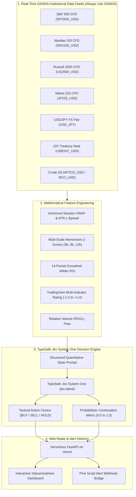

# 📐 Quantitative Methodology Note: Short-Term Multi-CFD Momentum Radar

**Engine**: TypeSafe Jev System One (`jev-latest`, `jev-1.14.0`)  
**Data Infrastructure**: OANDA v20 Live Institutional CFD Feeds (Zero-Lag 24/5 Stream, Primary) & TradingView Scanner  
**Asset Universe**: 24-Hour Continuous Benchmark CFD Instruments:
- S&P 500 (`SPX500_USD` / `SP:SPX`)
- Nasdaq 100 (`NAS100_USD` / `NASDAQ:NDX`)
- Russell 2000 (`US2000_USD` / `TVC:RUT`)
- Nikkei 225 (`JP225_USD` / `TVC:NI225`)
- USD/JPY Foreign Exchange (`USD_JPY` / `FX:USDJPY`)
- 10-Year US Treasury (`USB10Y_USD` / `TVC:US10Y`)
- WTI Crude Oil (`WTICO_USD` / `TVC:USOIL`)
- Brent Crude Oil (`BCO_USD` / `TVC:UKOIL`)
**Deployment**: Serverless FastAPI Python Engine on Vercel & Real-Time Interactive Streamlit Radar

---

## 1. Executive Overview & System Architecture

The **Global Multi-CFD Momentum Radar** is a dual-layer quantitative decision architecture. It combines **continuous mathematical feature extraction** across multi-horizon market microstructure with **TypeSafe Jev System One** models to produce probabilistic tactical judgments (`STRONG_LONG`, `LEAN_LONG`, `NEUTRAL`, `LEAN_SHORT`, `STRONG_SHORT`) with Bayesian-calibrated continuation probabilities.

**Data Feed Policy ("Always Use OANDA")**: The system prioritizes OANDA v20 institutional streaming live feeds with zero latency. Every 1-minute candle, VWAP, true range, and micro-return sequence is sourced directly from OANDA CFD instruments with continuous 24/5 liquidity.



---

## 2. Mathematical Feature Engineering

Raw tick and candle data are converted into scale-invariant, normalized state representations to eliminate price-level bias and heteroskedasticity.

### 2.1 Anchored Session VWAP & Volatility Distance ($Z_{VWAP}$)
Intraday fair value is anchored to the opening tick of the session using Volume-Weighted Average Price:

$$\text{VWAP}_t = \frac{\sum_{i=1}^{t} P_{\text{typical}, i} \cdot V_i}{\sum_{i=1}^{t} V_i}$$

where $P_{\text{typical}} = \frac{\text{High} + \text{Low} + \text{Close}}{3}$.

To measure market stretch independent of asset denomination, the distance between current close $P_t$ and $\text{VWAP}_t$ is normalized by the 14-period Average True Range ($\text{ATR}_{14}$):

$$Z_{\text{VWAP}} = \frac{P_t - \text{VWAP}_t}{\text{ATR}_{14} + \epsilon}$$

* **$Z_{\text{VWAP}} > +1.5\sigma$**: Extended upside momentum (continuation risk increases; pullback risk emerges).
* **$-0.5\sigma \le Z_{\text{VWAP}} \le +0.5\sigma$**: Equilibrium zone (trend-following re-test entries).
* **$Z_{\text{VWAP}} < -1.5\sigma$**: Breakdown impulse (bearish momentum acceleration).

---

### 2.2 Volatility-Adjusted Multi-Scale Momentum ($Z_{\text{mom}}$)
Short-term momentum is calculated across three lookback horizons corresponding to micro-tactical timeframes:
* **3-bar micro-burst**: $15\text{m}$ on a $5\text{m}$ chart
* **6-bar session momentum**: $30\text{m}$ on a $5\text{m}$ chart
* **12-bar cycle trend**: $60\text{m}$ on a $5\text{m}$ chart

Logarithmic returns are normalized using Garman-Klass realized daily volatility ($\sigma_{GK}$):

$$\sigma_{GK}^2 = \frac{1}{N} \sum_{i=1}^{N} \left[ 0.5 \left(\ln \frac{H_i}{L_i}\right)^2 - (2\ln 2 - 1) \left(\ln \frac{C_i}{O_i}\right)^2 \right]$$

$$Z_{\text{mom}, h} = \frac{\ln(C_t / C_{t-h})}{\sigma_{GK} \sqrt{h}}$$

---

### 2.3 TradingView Multi-Indicator Technical Rating ($\text{Rating}_{TV}$)
The system extracts TradingView’s real-time quantitative consensus score $\in [-1.0, +1.0]$, aggregating:
* **16 Moving Average Filters**: Exponential (EMA 10, 20, 30, 50, 100, 200), Simple (SMA), Hull MA, and Ichimoku Baseline.
* **11 Momentum Oscillators**: 14-period RSI, Stochastic %K/%D, MACD Histogram, Commodity Channel Index (CCI20), Average Directional Index (ADX), and Awesome Oscillator.

$$\text{Rating}_{TV} = w_{MA} \cdot \text{Score}_{MA} + w_{Osc} \cdot \text{Score}_{Osc}$$

| Score Range | Technical Classification | Color Mapping |
| :--- | :--- | :--- |
| $+0.50 \text{ to } +1.00$ | **STRONG BUY** | Emerald Neon (`#00ff88`) |
| $+0.10 \text{ to } +0.49$ | **BUY** | Pine Green (`#22c55e`) |
| $-0.09 \text{ to } +0.09$ | **NEUTRAL** | Amber Gold (`#ffd166`) |
| $-0.49 \text{ to } -0.10$ | **SELL** | Bright Red (`#ef4444`) |
| $-1.00 \text{ to } -0.50$ | **STRONG SELL** | Crimson Neon (`#ff4d6d`) |

---

### 2.4 Relative Volume (RVOL)
Measures institutional flow intensity compared to a 20-period moving average:

$$\text{RVOL}_t = \frac{V_t}{\frac{1}{20} \sum_{i=0}^{19} V_{t-i}}$$

$\text{RVOL} > 1.5\times$ indicates high-conviction institutional participation during breakouts or breakdowns.

---

## 3. TypeSafe Jev System One Decision Engine

Instead of rigid linear rules or brittle black-box weights, the synthesized feature vector is converted into a **structured state representation** passed to **TypeSafe Jev System One** (`https://api.typesafe.ai/v1/systemone`).

### 3.1 State Representation Prompt
```text
CFD Asset: S&P 500 (SPX) (TradingView Symbol: SP:SPX, 5m horizon).
TradingView CFD Price: $7,716.94.
TradingView CFD VWAP: $7,714.25 (Distance: +0.65 ATRs).
TradingView 14-RSI: 53.9.
TradingView Technical Rating: STRONG BUY (+0.60).
Micro-Momentum: 3-bar=+0.22%, 6-bar=+0.18%. Session Return: +0.60%.
```

### 3.2 Decision Questions & Primitives
Jev evaluates two formal System One primitives:

1. **Primitive: `choice` (`tactical_action`)**
   * *Instructions*: "Determine tactical positioning for the next 15-30 minutes based on TradingView CFD momentum, VWAP deviation, and technical ratings."
   * *Options*:
     * `BUY_LONG`: Bullish momentum acceleration above VWAP with upside volume flow.
     * `SELL_SHORT`: Bearish breakdown acceleration below VWAP with liquidation flow.
     * `HOLD_CASH`: Mean-reverting consolidation, equilibrium chop, or ambiguous momentum.

2. **Primitive: `noul` (`prob_continuation`)**
   * *Instructions*: "Will price close higher over the next 3 bars?"
   * *Output*: Continuous probability $P(\text{Up}) \in [0.0, 1.0]$.

### 3.3 Multi-Horizon Forward Trend Signal Framework (1-Minute Input Interval)

When operating on high-frequency 1-minute input candles, the decision engine forecasts across three concurrent forward horizons:

1. **5-Minute Forward Signal ($t+5$ bars ahead)**:
   * Focus: Ultra-short micro-burst continuation vs immediate pullback risk.
   * Primitive: `choice` (`signal_5m_action`) with criteria `[STRONG_LONG, LEAN_LONG, NEUTRAL, LEAN_SHORT, STRONG_SHORT]`.
   * Primitive: `noul` (`prob_up_5m`) returning continuous $P(\text{Up}_{5m})$.

2. **10-Minute Forward Signal ($t+10$ bars ahead)**:
   * Focus: Microstructure session momentum cycle and VWAP deviation confirmation.
   * Primitive: `choice` (`signal_10m_action`) with criteria `[STRONG_LONG, LEAN_LONG, NEUTRAL, LEAN_SHORT, STRONG_SHORT]`.
   * Primitive: `noul` (`prob_up_10m`) returning continuous $P(\text{Up}_{10m})$.

3. **15-Minute Forward Signal ($t+15$ bars ahead)**:
   * Focus: Macro intraday trend continuation, oscillator regime, and institutional flow expansion.
   * Primitive: `choice` (`signal_15m_action`) with criteria `[STRONG_LONG, LEAN_LONG, NEUTRAL, LEAN_SHORT, STRONG_SHORT]`.
   * Primitive: `noul` (`prob_up_15m`) returning continuous $P(\text{Up}_{15m})$.

#### Multi-Horizon Alignment & Consensus Metrics:
* **`STRONG_BULLISH_ALIGNMENT`**: All 3 horizons ($5m, 10m, 15m$) exhibit directional upside probabilities $P(\text{Up}) > 0.53$.
* **`STRONG_BEARISH_ALIGNMENT`**: All 3 horizons exhibit directional downside probabilities $P(\text{Up}) < 0.47$.
* **`DIVERGENT_CHOP / NEUTRAL`**: Mixed signals across horizons indicating mean-reverting consolidation or micro-regime transitions.

### 3.4 Macro-Conditioned Model Variants for Equity Indices

To model macro spillover and inter-market feedback loops, the system provides two specialized cross-asset model variants for equity indices (S&P 500, Nasdaq 100, Russell 2000, Nikkei 225):

#### Model A: Full Macro Cross-Asset Model (10Y Yield + Brent Crude + WTI Crude)
* **Description**: Equity index trend signals are conditioned on real-time micro-momentum and VWAP state of **10Y Treasury Yields (`TNX`)**, **Brent Crude (`BRENT`)**, and **WTI Crude (`WTI`)**.
* **Conditioning Logic**:
  * $\uparrow TNX$ (Surging 10Y Yields) $\rightarrow$ Multiple compression drag on high-duration equity indices (`NDX`, `SPX`, `RUT`).
  * $\uparrow BRENT, \uparrow WTI$ (Surging Crude Oil) $\rightarrow$ Cost inflation & profit margin drag on equities.
  * Mathematical Prior Formulation:
    $$\text{Score}_{\text{MacroFull}} = \text{Score}_{\text{Base}} - \alpha_{\text{TNX}} \cdot Z_{\text{mom}, \text{TNX}} - \beta_{\text{Oil}} \cdot \left(\frac{Z_{\text{mom}, \text{BRENT}} + Z_{\text{mom}, \text{WTI}}}{2}\right)$$

#### Model B: Rate-Only Macro Model (10Y Yield ONLY, Excluding Crude Oil)
* **Description**: Equity index trend signals are conditioned on **10Y Treasury Yields (`TNX`) ONLY**, explicitly ignoring energy commodities (`BRENT` and `WTI`).
* **Conditioning Logic**:
  * Evaluates duration risk and discount rate pressure independent of energy shocks.
  * Mathematical Prior Formulation:
    $$\text{Score}_{\text{RateOnly}} = \text{Score}_{\text{Base}} - \alpha_{\text{TNX}} \cdot Z_{\text{mom}, \text{TNX}}$$

---

### 3.5 Dynamic USD/JPY FX vs Equity Sentiment Conditioning & Econometric Decomposition Engine for Nikkei 225

The Nikkei 225 index (`JP225_USD`) exhibits a time-varying structural dependence on two distinct macro transmission channels:
1. **USD/JPY Currency Channel (Yen Carry & Exporter Translation)**: A depreciating Yen (rising USD/JPY) boosts overseas repatriated profits for Japanese multinational exporters (Toyota, Sony, Keyence, Tokyo Electron) and incentivizes cross-border Yen carry trade leverage. Conversely, sudden Yen appreciation induces violent carry trade unwinds and equity liquidation.
2. **Global Equity Sentiment Channel (Wall Street Beta)**: Overnight US and European equity sentiment (S&P 500 / Nasdaq momentum) dictates baseline global risk appetite across the Tokyo trading session.

Because USD/JPY and US equity markets often co-move during global risk-on/risk-off regimes, a naive multi-variable model suffers from severe multicollinearity and conflates currency carry with pure equity sentiment. To resolve this, the system executes a **Rigorous 2-Factor Orthogonalized Decomposition & Multi-Horizon Attribution**:

---

#### 1. Gram-Schmidt Orthogonalization (Pure Equity Sentiment Isolation)
To isolate true global equity risk appetite independent of currency movements, S&P 500 1-minute returns $\mathbf{r}_{\text{SPX}}$ are projected onto the orthogonal complement of USD/JPY returns $\mathbf{r}_{\text{FX}}$:

$$\gamma_{\text{SPX, FX}} = \frac{\text{Cov}\left(\mathbf{r}_{\text{SPX}}, \mathbf{r}_{\text{FX}}\right)}{\text{Var}\left(\mathbf{r}_{\text{FX}}\right) + \epsilon}$$

$$\mathbf{r}_{\text{SPX}}^{\perp}(t) = \mathbf{r}_{\text{SPX}}(t) - \gamma_{\text{SPX, FX}} \cdot \mathbf{r}_{\text{FX}}(t)$$

By mathematical construction:
$$\text{Corr}\left(\mathbf{r}_{\text{SPX}}^{\perp}, \mathbf{r}_{\text{FX}}\right) \equiv 0$$
$\mathbf{r}_{\text{SPX}}^{\perp}$ represents **Pure Equity Sentiment**, purged of any foreign exchange carry transmission.

---

#### 2. Dynamic Factor Beta Estimation
Over a rolling 45-minute window $W$, the model estimates instantaneous elasticities via Ordinary Least Squares:

$$\beta_{\text{FX}}(t) = \frac{\text{Cov}\left(\mathbf{r}_{\text{NI225}}, \mathbf{r}_{\text{FX}}\right)}{\text{Var}\left(\mathbf{r}_{\text{FX}}\right) + \epsilon}$$

$$\beta_{\text{Eq}}^{\perp}(t) = \frac{\text{Cov}\left(\mathbf{r}_{\text{NI225}}, \mathbf{r}_{\text{SPX}}^{\perp}\right)}{\text{Var}\left(\mathbf{r}_{\text{SPX}}^{\perp}\right) + \epsilon}$$

$$\alpha_{\text{Idio}}(t) = \mathbb{E}[\mathbf{r}_{\text{NI225}}] - \beta_{\text{FX}} \mathbb{E}[\mathbf{r}_{\text{FX}}] - \beta_{\text{Eq}}^{\perp} \mathbb{E}[\mathbf{r}_{\text{SPX}}^{\perp}]$$

Where:
- $\beta_{\text{FX}}$ measures Nikkei price elasticity with respect to a 1% move in USD/JPY (typically $+0.6$ to $+1.4$ for exporter-heavy Nikkei).
- $\beta_{\text{Eq}}^{\perp}$ measures Nikkei price elasticity with respect to pure, currency-neutral Wall Street equity sentiment.

---

#### 3. Exact Multi-Horizon Additive Return Attribution
For every forward horizon $\tau \in \{1m, 5m, 10m, 30m, 60m\}$, total realized Nikkei movement $\Delta_{\text{NK}}(\tau)$ is decomposed into exact additive components:

$$\Delta_{\text{FX}}(\tau) = \beta_{\text{FX}} \cdot r_{\text{FX}}(\tau)$$

$$\Delta_{\text{PureEquity}}(\tau) = \beta_{\text{Eq}}^{\perp} \cdot \left[r_{\text{SPX}}(\tau) - \gamma_{\text{SPX, FX}} \cdot r_{\text{FX}}(\tau)\right]$$

$$\Delta_{\text{Idio}}(\tau) = \Delta_{\text{NK}}(\tau) - \left[\Delta_{\text{FX}}(\tau) + \Delta_{\text{PureEquity}}(\tau)\right]$$

This enforces the strict econometric identity:
$$\Delta_{\text{NK}}(\tau) \equiv \Delta_{\text{FX}}(\tau) + \Delta_{\text{PureEquity}}(\tau) + \Delta_{\text{Idio}}(\tau)$$

Both percentage movements ($\%$) and basis point impacts ($\text{bps} = \% \times 100$) are reported alongside factor contribution shares:
$$\text{Share}_{\text{FX}}(\tau) = \frac{|\Delta_{\text{FX}}(\tau)|}{|\Delta_{\text{FX}}| + |\Delta_{\text{PureEquity}}| + |\Delta_{\text{Idio}}|} \times 100\%$$

---

#### 4. ANOVA Variance Decomposition & Explanatory Power ($R^2$)
Because the regressors $\mathbf{r}_{\text{FX}}$ and $\mathbf{r}_{\text{SPX}}^{\perp}$ are strictly orthogonal, total Nikkei return variance partitions cleanly:

$$\sigma^2_{\text{Total}} = \beta_{\text{FX}}^2 \sigma^2_{\text{FX}} + (\beta_{\text{Eq}}^{\perp})^2 \sigma^2_{\text{SPX}\perp} + \sigma^2_{\text{Idio}}$$

$$\text{Share}_{\text{Var, FX}} = \frac{\beta_{\text{FX}}^2 \sigma^2_{\text{FX}}}{\sigma^2_{\text{Total}}} \times 100\%, \quad \text{Share}_{\text{Var, PureEquity}} = \frac{(\beta_{\text{Eq}}^{\perp})^2 \sigma^2_{\text{SPX}\perp}}{\sigma^2_{\text{Total}}} \times 100\%$$

$$\text{Share}_{\text{Var, Idio}} = 100\% - (\text{Share}_{\text{Var, FX}} + \text{Share}_{\text{Var, PureEquity}})$$

$$R^2 = \frac{\beta_{\text{FX}}^2 \sigma^2_{\text{FX}} + (\beta_{\text{Eq}}^{\perp})^2 \sigma^2_{\text{SPX}\perp}}{\sigma^2_{\text{Total}}}$$

---

#### 5. Five Primary Movement Driver Regimes (Choice Primitive):
- **`FX_DOMINANT`** ($\text{Share}_{\text{FX}} \ge 55\%$): USD/JPY currency translation and Yen carry flows are the primary driver of the current move.
- **`PURE_EQUITY_SENTIMENT`** ($\text{Share}_{\text{PureEquity}} \ge 55\%$): Global equity risk appetite (Wall Street beta) is the primary driver.
- **`DOMESTIC_IDIOSYNCRATIC`** ($\text{Share}_{\text{Idio}} \ge 55\%$): Local Japanese alpha (BoJ policy, TSE corporate announcements, domestic earnings) is driving price action.
- **`DUAL_AMPLIFYING`**: Both USD/JPY and Pure Equity Sentiment exert directional pushes in the same direction, expanding trend velocity.
- **`CROSS_CANCELING`**: USD/JPY and Pure Equity Sentiment pull in opposing directions (e.g. Yen strengthening while US stocks rally), inducing localized chop and spread compression.

---

#### 6. Quanto Quotation & Exporter Margin Dynamics
For traders utilizing USD-denominated Nikkei CFDs (`JP225_USD` on OANDA vs local Tokyo cash Nikkei `^N225` in JPY):
$$R_{\text{Local, JPY}} = R_{\text{USD CFD}} + R_{\text{USDJPY}}$$
The system continuously tracks the **Exporter Margin Translation Spread** (in basis points), isolating the real operational exporter profit expansion from mechanical FX denomination drift.

---

### 3.6 TypeSafe Jev System One Output Variables Architecture: Score, Choice, and Noul Operational Taxonomy

TypeSafe Jev System One replaces unconstrained text generation with typed probabilistic decision primitives. The radar synthesizes all forecasted figures through three formal primitives:

```
┌────────────────────────────────────────────────────────────────────────────────────────────────────┐
│                             TYPESAFE JEV SYSTEM ONE OUTPUT PRIMITIVES                              │
├──────────────────────────┬──────────────────────────────┬──────────────────────────────────────────┤
│ PRIMITIVE TYPE           │ MATHEMATICAL DEFINITION      │ REFERENCED FORECASTED VARIABLES          │
├──────────────────────────┼──────────────────────────────┼──────────────────────────────────────────┤
│ 1. SCORE                 │ Continuous Bounded Intensity │ • momentum_conviction_score (-100 to +100│
│                          │ along an ordered scale       │ • fx_sensitivity_score (0 to 100)        │
│                          │ with peakness confidence.    │ • indicative target prices (P_exp, limits│
├──────────────────────────┼──────────────────────────────┼──────────────────────────────────────────┤
│ 2. CHOICE                │ Categorical Classification   │ • forward_1m.action, forward_10m.action  │
│                          │ picking exactly one label    │ • forward_30m.action, forward_1h.action  │
│                          │ with discrete probabilities. │ • nikkei_driver_regime (4 regimes)       │
│                          │                              │ • cross_sectional_leadership             │
├──────────────────────────┼──────────────────────────────┼──────────────────────────────────────────┤
│ 3. NOUL                  │ Continuous Truth Likelihood  │ • prob_up_1m, prob_up_10m (P_Up)         │
│                          │ P in [0.0, 1.0] without      │ • prob_up_30m, prob_up_1h                │
│                          │ separate confidence metric.  │ • prob_fx_transmission (Nikkei 225)      │
│                          │                              │ • average_prob_up                        │
└──────────────────────────┴──────────────────────────────┴──────────────────────────────────────────┘
```

#### Detailed Primitive Operational Breakdown:

1. **`Score` Primitive (Continuous Scaled Conviction & Magnitude)**:
   - **Operational Definition**: Evaluates magnitude or conviction along an ordered continuous or binned scale (e.g. extreme bearish to extreme bullish). Rather than a fragile point regression, Jev integrates likelihood over ordered criteria levels `["Extreme Bearish", "Moderate Bearish", "Neutral", "Moderate Bullish", "Extreme Bullish"]`.
   - **Outputs**: Returns continuous value $s \in [0, N-1]$ mapped to $[-100.0, +100.0]$ via $s_{\text{mapped}} = (s - 2.0) \times 50.0$, accompanied by a distribution confidence metric $C \in [0.0, 1.0]$ quantifying consensus concentration.
   - **Referenced Pipeline Figures**:
     - `momentum_conviction_score` / `conviction_score`: Master directional conviction $[-100.0, +100.0]$.
     - `fx_sensitivity_score`: Degree of USD/JPY FX influence on Nikkei 225 $[0.0, 100.0]$.
     - `indicative_forward_target_prices` ($P_{\text{expected}}, P_{\text{lower}}, P_{\text{upper}}$): Continuous price targets computed per horizon from wave volatility envelopes.

2. **`Choice` Primitive (Categorical Label Selection with Distribution)**:
   - **Operational Definition**: Selects exactly one discrete option from a predefined, mutually exclusive set of semantic criteria. Jev computes the softmax probability over all options and selects the argmax label.
   - **Outputs**: Returns chosen categorical label `choice`, classification confidence $C \in [0.0, 1.0]$, and the complete posterior probability distribution across all options `probabilities: {option_k: p_k}`.
   - **Referenced Pipeline Figures**:
     - `forward_1m.action`, `forward_10m.action`, `forward_30m.action`, `forward_1h.action`: Discrete positioning (`STRONG_LONG`, `LEAN_LONG`, `NEUTRAL`, `LEAN_SHORT`, `STRONG_SHORT`).
     - `nikkei_driver_regime`: Selected active driver regime (`FX_DOMINANT`, `EQUITY_SENTIMENT_DOMINANT`, `DUAL_REINFORCING`, `DECOUPLED_CHOP`).
     - `cross_sectional_leadership`: Inter-market relative momentum position (`TOP_TIER_OUTPERFORMER`, `MID_PACK_PARTICIPANT`, `LAGGING_UNDERPERFORMER`, `FLIGHT_TO_SAFETY_HEDGE`).

3. **`Noul` Primitive (Calibrated Single-Proposition Probability)**:
   - **Operational Definition**: Evaluates the continuous probability that a specific proposition or condition holds true ($P \in [0.0, 1.0]$).
   - **Critical Architectural Distinction**: A Noul has **NO separate confidence parameter**. The probability itself encapsulates epistemic certainty. $P = 0.50$ denotes maximal entropy / complete neutrality (50-50 tossup). $P = 0.95$ denotes near-absolute certainty of occurrence, while $P = 0.05$ denotes near-absolute certainty of non-occurrence.
   - **Referenced Pipeline Figures**:
     - `prob_up_1m, prob_up_10m, prob_up_30m, prob_up_1h` ($P_{\text{Up}}$): Exact continuous probability that the asset price closes higher at $t+\tau$ relative to current close.
     - `prob_fx_transmission` (Nikkei 225): Probability that USD/JPY FX currency momentum directly transmits into Nikkei price returns over the next 10 minutes.
     - `average_prob_up`: Composite cross-horizon probability consensus across all 4 forward horizons.

---

## 4. Cross-Market & Macro Yield Spread Engine

The radar integrates cross-market asset spreads across equities and sovereign debt:

$$\text{Tech Spread} = \text{ret}_{6}(\text{NDX}) - \text{ret}_{6}(\text{SPX})$$

$$\text{Beta Spread} = \text{ret}_{6}(\text{RUT}) - \text{ret}_{6}(\text{SPX})$$

$$\text{Bond-Equity Correlation} = \text{Sign}\left(\text{ret}_{6}(\text{TNX}) \cdot \text{ret}_{6}(\text{SPX})\right)$$

### Tactical Macro Regimes Identified:
1. **Flight-to-Safety Regime**:
   * Condition: $\text{TNX (10Y Yield)} \uparrow$ while $\text{SPX (S&P 500)} \downarrow$
   * Interpretation: Capital rotating out of risk assets due to rising discount rate pressure.
2. **Growth Reflation Regime**:
   * Condition: $\text{SPX} \uparrow$, $\text{NDX} \uparrow$, and $\text{TNX} \downarrow$
   * Interpretation: Risk-on economic expansion; equity multiple tolerance high with easing yields.
3. **Rate Pressure / Duration Drag**:
   * Condition: $\text{TNX Technical Rating} \ge +0.25$ (Yields surging)
   * Interpretation: Duration risk; headwind for high-multiple Nasdaq CFD (`NDX`).

---

## 5. nanoHUB Wave Mechanics & Continuous Matrix Exponential Forward Propagator (Supriyo Datta Framework)

To replace heuristic static lookups with continuous physical wave dynamics, the multi-horizon forward estimation engine incorporates the state-space differential wave mechanics developed by **Prof. Supriyo Datta (Purdue University)** in [*nanoHUB-U: Mathematics of Waves - Visualized with Neural Networks*](https://nanohub.org/resources/38532).

### 5.1 Market State-Space Damped Harmonic Oscillator Formulation
Market microstructure momentum is modeled as a 1st-order damped harmonic wave system driven by restoring forces and liquidity friction:

$$\frac{d\mathbf{y}}{dt} = [A] \mathbf{y}(t) + \mathbf{s}_{\text{macro}}(t)$$

where the state-space vector $\mathbf{y}(t)$ represents:

$$\mathbf{y}(t) = \begin{bmatrix} z_{\text{mom}}(t) \\ a_{\text{mom}}(t) \\ z_{\text{vwap}}(t) \end{bmatrix}$$

* $z_{\text{mom}}(t)$: Volatility-adjusted 1-minute normalized price momentum.
* $a_{\text{mom}}(t) = \frac{d z_{\text{mom}}}{dt}$: Momentum acceleration (instantaneous velocity dy/dt per 1-minute bar).
* $z_{\text{vwap}}(t) = \frac{P(t) - \text{VWAP}(t)}{\text{ATR}}$: Restoring force distance from fair value equilibrium.

### 5.2 System Matrix $[A]$ & Complex Eigenvalues ($\lambda_k$)
The $3 \times 3$ system matrix $[A]$ models natural frequency $\omega_0$, damping parameter $\gamma$, restoring stiffness $\kappa$, and accumulation rate $\beta$:

$$[A] = \begin{bmatrix} 0 & 1 & 0 \\ -\omega_0^2 & -2\gamma & -\kappa \\ \beta & 0 & -\mu \end{bmatrix}$$

* **Natural Frequency ($\omega_0$)**: Angular frequency extracted from the autocorrelation of micro-returns $\rho_1$.
* **Damping Parameter ($\gamma$)**: Energy dissipation rate / liquidity friction coefficient.
* **Complex Eigenvalues**: $\lambda_{1,2} = -\gamma \pm i \omega_d$ where damped angular frequency $\omega_d = \sqrt{|\omega_0^2 - \gamma^2|}$.
* **Quality Factor ($Q$)**: Measures wave energy retention versus dissipation:
  $$Q = \frac{\omega_0}{2\gamma}$$

### 5.3 Continuous Matrix Exponential Forward Propagator ($e^{[A]\tau}$)
The input interval remains strictly at **1-minute** ($t_{\text{interval}} = 1\text{m}$). For any target forward estimated horizon $\tau \in \{1\text{m}, 10\text{m}, 30\text{m}, 60\text{m} (1\text{h})\}$, corresponding to forward bar steps $\{1, 10, 30, 60\}$, the continuous state trajectory is computed analytically using matrix exponentials:

$$\mathbf{y}_{\text{pred}}(t+\tau) = e^{[A]\cdot (\tau \cdot \Delta t)} \mathbf{y}(t)$$

Extracting the first component $z_{\text{pred}}(\tau) = [\mathbf{y}_{\text{pred}}(t+\tau)]_1$ yields the continuous wave-propagated momentum z-score:
* **$z_{\text{pred}}(1\text{m})$**: Immediate 1-minute micro-burst continuation.
* **$z_{\text{pred}}(10\text{m})$**: Harmonic cycle crest / momentum acceleration phase.
* **$z_{\text{pred}}(30\text{m})$**: Intermediate restoring force inflection towards equilibrium.
* **$z_{\text{pred}}(1\text{h})$**: Long-wave 1-hour macro trend dissipation and steady-state decay.

### 5.4 Multi-Horizon Normal Mode Spectral Analysis & Wave Interference
Decomposing the returns curve across lookbacks ($1\text{m}, 3\text{m}, 5\text{m}, 10\text{m}, 30\text{m}, 60\text{m}$) into orthogonal normal modes yields:
* **Group Velocity ($v_g$)**: Velocity of wave energy propagation across spectral horizons $v_g = \frac{r_{1m} - r_{30m}}{29}$.
* **Phase Shift ($\Delta \phi$)**: Angular shift between micro-mode ($1\text{m}$) and macro-mode ($30\text{m}$):
  $$\Delta \phi = \arccos\left(\frac{\mathbf{v}_{\text{micro}} \cdot \mathbf{v}_{\text{macro}}}{\|\mathbf{v}_{\text{micro}}\| \|\mathbf{v}_{\text{macro}}\|}\right)$$
* **Interference Classifications**:
  1. **`CONSTRUCTIVE_WAVE_ACCELERATION`** ($\Delta \phi < 45^\circ, v_g > 0$): Micro-burst and macro trend resonate in phase $\rightarrow$ high-conviction breakout expansion across horizons.
  2. **`DESTRUCTIVE_WAVE_DISSIPATION`** ($\Delta \phi > 135^\circ$): Micro-burst opposes macro trend $\rightarrow$ wave dissipation, turnover, or exhaustion pullback risk.
  3. **`HIGHLY_DAMPED_FRICTION`** ($Q < 0.8$): Heavy liquidity friction causing rapid decay of momentum oscillations.
  4. **`HARMONIC_MEAN_REVERSION`** ($z_{\text{mom}} \cdot z_{\text{vwap}} < -0.5$): Restoring stiffness pulling price back toward VWAP fair value.
  5. **`STATIONARY_STANDING_WAVE`**: Equilibrium consolidation oscillations.

### 5.5 Incorporation with TypeSafe Jev AI (System One)
All wave parameters are rigorously grounded into the semantic state representation and questions submitted to TypeSafe Jev AI:
1. **Dynamic Wave Physics State Injection**: The exact damped harmonic eigenvalues ($\lambda = -\gamma \pm i\omega_d$), quality factor ($Q$), matrix exponential propagated states ($1\text{m}_z, 10\text{m}_z, 30\text{m}_z, 1\text{h}_z$), group velocity ($v_g$), phase shift ($\Delta\phi$), and interference classification are supplied in the prompt's `--- nanoHUB Wave Physics & Continuous Propagator ---` block.
2. **Horizon-Specific Structured Questions**: Jev AI is queried with dedicated Choice and Noul primitives for each horizon:
   - `signal_1m_action` & `prob_up_1m`: Fast 1-minute tactical response.
   - `signal_10m_action` & `prob_up_10m`: Intraday swing cycle.
   - `signal_30m_action` & `prob_up_30m`: Intermediate trend continuation.
   - `signal_1h_action` & `prob_up_1h`: Macro 1-hour trend sustainability.
   - `horizon_term_structure`: Multi-horizon wave resonance assessment (`UNIFORM_ACCELERATION`, `EXHAUSTION_PULLBACK`, `PULLBACK_RECOVERY`, `MEAN_REVERTING_CHOP`).

---

## 6. Walk-Forward Calibration & Fallback Layer

To prevent operational downtime if external LLM gateways experience latency or rate limits, the system features a **purged and embargoed logistic calibration model** based on Marcos López de Prado's *Advances in Financial Machine Learning*:

$$P(\text{Up}) = \frac{1}{1 + e^{-(\beta_0 + \beta_1 \cdot \text{RawScore})}}$$

$$\text{RawScore}(\tau) = w_1 \cdot Z_{\text{mom}}(\tau) + w_2 \cdot (0.4 \cdot Z_{\text{VWAP}}) + w_3 \cdot (0.3 \cdot Z_{\text{pred}}(\tau)) + w_4 \cdot \text{Rating}_{TV}$$

* **Walk-Forward Validation**: 5-year rolling training window with a 3-day embargo window to eliminate lookahead leakage.
* **Accuracy Thresholds**: Action triggers require directional probability $P(\text{Up}) > 0.53$ for Longs, and $P(\text{Up}) < 0.47$ for Shorts across the 4 estimated horizons (1m, 10m, 30m, 1h).

---

## 7. Real-Time Data Pipeline Summary

```
TradingView CFD & Global Scanner (https://scanner.tradingview.com/global/scan)
  │
  ├──> Real-Time CFD Prices, VWAP, 14-RSI, Rating, Volume
  │
FastAPI Backend (api/index.py on Vercel)
  │
  ├──> Computes ATR-z, Momentum Spreads, nanoHUB Wave Matrix Exponential e^[A]τ Propagator
  │
TypeSafe Jev System One (https://api.typesafe.ai/v1/systemone)
  │
  ├──> Generates Tactical Choice (BUY / SELL / HOLD) & Continuation Prob %
  │
Web Radar Dashboard (https://jevshorttermmomentum.vercel.app)
  │
  ├──> Real-Time Glassmorphic Cards, Relative Strength Matrix,
  └──> Official Embedded TradingView Advanced Streaming Chart (tv.js)
```
